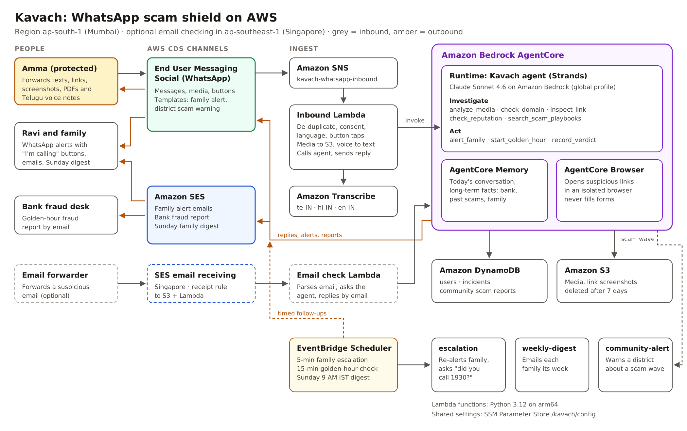

# Kavach: a WhatsApp scam shield for Indian families

Kavach (कवच, "shield") lets anyone forward a suspicious message, link, screenshot, PDF or Telugu/Hindi
voice note on WhatsApp and get a clear verdict in their own language within a minute. An AI agent on
**Amazon Bedrock AgentCore** investigates with real tools. When someone is in danger, such as a live
"digital arrest" video call or money already sent, Kavach alerts the family on WhatsApp with
tap-to-confirm buttons, escalates if nobody answers, and runs a golden-hour response (1930 guidance plus
an emailed fraud report).

Built for the AWS Communication Developer Services (CDS) Agentic AI Partner Hackathon.



## AWS services used

| Service | What Kavach uses it for |
| --- | --- |
| **AWS End User Messaging Social (WhatsApp)** | Inbound messages and media via SNS; replies, interactive buttons, approved templates for family alerts and district scam warnings |
| **Amazon SES** | Family alert emails, golden-hour fraud report to the bank desk, Sunday family digest, optional forwarded-email checking (SES receiving) |
| **Amazon Bedrock AgentCore Runtime** | Hosts the Strands agent (`agent/`) |
| **AgentCore Memory** | Short-term conversation plus long-term facts per person (bank, past scams) |
| **AgentCore Browser** | Opens suspicious links in an isolated cloud browser and reports what the page asks for |
| **Amazon Bedrock (Claude Sonnet 4.6, global profile from Mumbai)** | Agent reasoning, plus reading screenshots and PDF "notices" |
| **Amazon Transcribe** | Telugu (te-IN), Hindi (hi-IN) and English (en-IN) voice notes |
| **AWS Lambda, Amazon SNS, Amazon DynamoDB, Amazon S3** | Message handling, users/incidents/community reports, media (deleted after 7 days) |
| **Amazon EventBridge Scheduler** | 5-minute family escalation timers, 15-minute golden-hour check-ins, weekly digest |
| **AWS Systems Manager Parameter Store** | One shared config (`/kavach/config`) |

Region: **ap-south-1 (Mumbai)**. The optional email-checking stack runs in **ap-southeast-1 (Singapore)**,
because SES email receiving isn't offered in Mumbai.

## Repository layout

```
agent/                    Kavach agent (Strands) for AgentCore Runtime
  main.py                 entrypoint: builds the agent per request, returns {"reply", "verdict", ...}
  prompts.py              system prompt (investigation steps, safety rules, reply format)
  tools/investigate.py    analyze_media, check_domain, inspect_link, check_reputation, search_scam_playbooks
  tools/act.py            alert_family, start_golden_hour, record_verdict
  playbooks.json          14 Indian scam playbooks with red flags and official facts
  kavach-agent-policy.json  extra IAM permissions for the runtime role
functions/                Lambda functions (Python 3.12, arm64)
  inbound/                WhatsApp in: onboarding, consent, buttons, media, voice, calls the agent
  escalation/             timer-driven family escalation and golden-hour check-in
  digest/                 Sunday family email
  community/              district scam-wave WhatsApp warning
  email_inbound/          optional: check forwarded emails (Singapore stack)
layers/common/kavach_common.py  shared WhatsApp/SES/DynamoDB helpers (Lambda layer + agent)
template.yaml             SAM stack for Mumbai
email-inbound.yaml        optional SAM stack for Singapore
scripts/                  install_agent.py, create_templates.sh, seed_demo.py, ask_agent.py, trigger_scam_wave.py
```

## Setup

Prerequisites: an AWS account, AWS CLI v2, AWS SAM CLI, Python 3.12, Node.js 20+, a Meta Business
portfolio and a phone number not yet registered on WhatsApp.

### 1. WhatsApp
1. In the **End User Messaging Social** console (Mumbai), link a WhatsApp Business Account and add your
   number. Note the **phone number ID** (`phone-number-id-...`) and the **WhatsApp Business Account ID**.
2. Submit the two templates: `./scripts/create_templates.sh <WABA_ID>` (or create them in the console
   from `scripts/whatsapp_templates/`).

### 2. Agent (AgentCore)
```bash
npm install -g @aws/agentcore
agentcore create --project-name KavachAgent --name Kavach --language Python \
  --framework Strands --model-provider Bedrock --memory longAndShortTerm --build CodeZip
python scripts/install_agent.py KavachAgent
cd KavachAgent && agentcore deploy && agentcore status   # copy the runtime ARN
```
Make sure `aws-targets.json` in the project points at `ap-south-1`.

### 3. Messaging backend (SAM)
```bash
sam build
sam deploy --guided --region ap-south-1 --capabilities CAPABILITY_NAMED_IAM
```
Parameters: `WhatsAppPhoneNumberId`, `AgentRuntimeArn`, `SenderEmail` and `BankFraudDeskEmail`
(both SES-verified). Then, in the End User Messaging Social console, set the WhatsApp Business Account's
**event destination** to the `InboundTopicArn` output.

### 4. Try it
```bash
python scripts/seed_demo.py --parent +9198XXXXXXXX --name "Lakshmi Amma" --language te \
  --district Kurnool --bank SBI --guardian "Ravi,+9198XXXXXXXX,ravi@example.com"
```
Then message the Kavach number from the parent's phone. Or test without WhatsApp:
`python scripts/ask_agent.py --arn <ARN> --phone +9198XXXXXXXX "Is this real? Your SBI account will be blocked, update KYC at sbi-kyc-update.xyz"`

### 5. Optional: forwarded-email checking
Verify a domain in SES **Singapore**, add an MX record to `inbound-smtp.ap-southeast-1.amazonaws.com`, then:
```bash
sam build -t email-inbound.yaml && sam deploy -t email-inbound.yaml --guided --region ap-southeast-1
aws ses set-active-receipt-rule-set --rule-set-name kavach-inbound --region ap-southeast-1
```

## Safety and privacy
- Consent is collected on WhatsApp before any check; `STOP` turns Kavach off.
- Media is deleted from S3 after 7 days. Community reports store the scammer's identifiers, never the
  reporter's number.
- Text inside screenshots and web pages is treated as untrusted evidence, never as instructions.
- Kavach never asks for OTPs, PINs or passwords, and does not fill or submit forms when it opens links.

## License
MIT. See [LICENSE](LICENSE).
